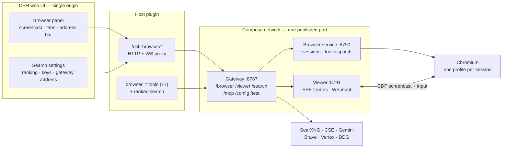
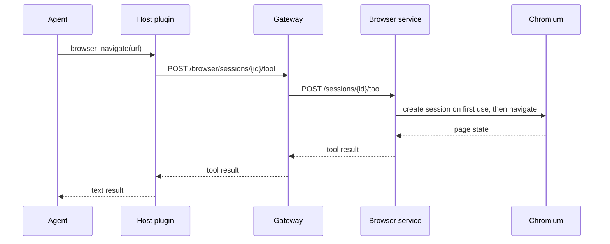

[](https://github.com/codeadeel/dsh-browser/blob/main/docs/demo/dsh-browser-demo.mp4)

**Click the preview to watch the full 35-second demo.** The agent searches, the human takes over, and the agent reads the page the human opened.

[Watch the full demo →](https://github.com/codeadeel/dsh-browser/blob/main/docs/demo/dsh-browser-demo.mp4)

## Introduction

An agent with browser tools can search, click, and read pages. What it cannot do is show you any of it. You get a tool log after the fact, and if something looks wrong, the best you can do is read the same page again and hope the result is deterministic.

[dsh-browser](https://github.com/codeadeel/dsh-browser) gives every DeepSeek Harness session a real Chromium, and puts that same browser in a panel inside the DSH UI. The agent drives it, you watch it, and you can take over whenever you want.

## What it is

- **A live panel.** The page the agent is on, streamed over CDP. Resizable, maximizable, with tabs and an address bar.
- **A ranked search gateway.** SearXNG, Google CSE, Gemini, Brave, Vertex, DuckDuckGo. First provider that returns results wins.
- **One browser per session.** The browser session id is the DSH session id. Separate profile, process, cookies, and tabs. Idle sessions clean themselves up, and deleting a workspace closes its browser sessions.

## Architecture

There are four moving parts: the DSH plugin, the gateway, the browser service, and the viewer. Only the plugin lives inside DSH; the gateway is the only published backend port.



### Session binding

The plugin registers its browser tools and ranked-search tool directly with DSH, so there is no per-session MCP server to wire into DSH and no per-session patch to write. A browser tool call carries the agent's DSH session id:



The manager tracks `lastActivityAt` per session and closes idle ones. The same id appears in the panel's session selector, which is why the human sees exactly the browser the agent is using.

### Viewer

The viewer is a thin CDP wrapper, not a remote desktop. Chromium sends JPEG screencast frames through `Page.startScreencast`; the viewer forwards them to the panel as SSE. Input goes the other way over a WebSocket, batched and serialized so rapid clicks cannot reorder. No VNC, no extension, no Xvfb.

Frames arrive only when the page repaints. That keeps bandwidth low for static pages, and the viewer nudges one repaint when a panel subscribes so you never stare at an empty card.

### Single origin

DSH is the only public surface. The browser panel, viewer, and settings use the host plugin’s `/dsh-browser/*` proxy, so those requests carry the DSH session cookie. The native ranked-search tool runs in the DSH host and calls the gateway’s `/search` endpoint using the plugin’s gateway URL. The gateway is the only published backend port; the browser, viewer, and search services stay on the compose network.

Installing the panel is enough: it registers the ranked search tool natively, with no separate MCP client or DSH patch. Changing the stack gateway address in the plugin page moves the browser, viewer, settings page, and the agent’s `web_search` at once.

### Search

The gateway is one port: `/browser` for the session API, `/viewer` for SSE and input, and search at the root (`/search`, `/mcp`, `/config`, `/test`, `/health`). Providers are ordered in the plugin page — the top one is tried first, unconfigured ones are skipped, and the first provider that returns results wins.

Keys are stored on the gateway, masked in the UI, and never returned in full. The whole stack has one gateway address, set in the plugin page, so it can run on another machine without separate backend ports.

Where an official service exists, the stack uses it: the SearXNG image, Brave's official MCP server, and Google's Gemini/Vertex/CSE APIs. A Brave key saved in the plugin page uses Brave REST immediately; the optional compose MCP service uses its startup env key. Gemini uses its UI key directly; move Gemini above SearXNG/CSE in the provider order to force it. The gateway owns the ranking, fallback, and key storage; the providers do the searching.

## Human in the loop

Google consent pages and CAPTCHAs happen. A blocked browser search returns `blocked: true` and the agent hands off to you. You finish the check in the panel, then tell it to continue. That handoff is the design, not a workaround — the project never automates CAPTCHA solving.

The page stays the same for both of you. After you navigate somewhere, the agent's next snapshot sees the page you opened. In the demo above, the follow-up question is answered from the Wikipedia article the human opened, not from whatever the agent had loaded before.

## Try it

```bash
git clone https://github.com/codeadeel/dsh-browser.git
cd dsh-browser
cp .env.example .env          # optional; defaults are fine
docker compose up -d --build

dsh plugin --profile web add "github:codeadeel/dsh-browser#path:panel"
dsh --profile web --no-open --host 127.0.0.1 --port 3000
```

The plugin can also be installed from the DSH UI: **Plugins → Add plugin**, paste the same address into the package field, and leave the registry selector on its default. The panel registers the ranked search tool natively, so no separate MCP client or DSH patch is needed. Then open the Browser panel, set the **Stack gateway address** in **Plugins → dsh-browser-panel** to the one reachable gateway URL, arrange providers, and run a test search.

All first-party services build from source; the base stack pulls only the official SearXNG image. There is no private registry. Only the gateway port is published on loopback; the browser, viewer, SearXNG, and Brave MCP stay on the compose network. For a remote DSH host, expose only the gateway on a private/VPN address and enter its URL in the plugin page.

## Links

- Repo: [github.com/codeadeel/dsh-browser](https://github.com/codeadeel/dsh-browser)
- Install guide: [docs/README.md](https://github.com/codeadeel/dsh-browser/blob/main/docs/README.md)
- Demo: [35-second video](https://github.com/codeadeel/dsh-browser/blob/main/docs/demo/dsh-browser-demo.mp4)
- Walkthrough: [docs/walkthrough.md](https://github.com/codeadeel/dsh-browser/blob/main/docs/walkthrough.md)
